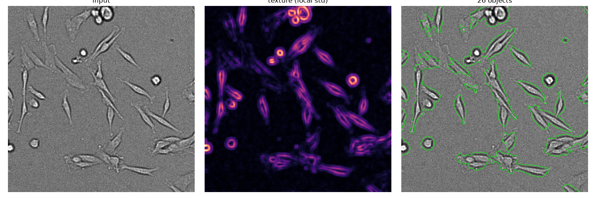
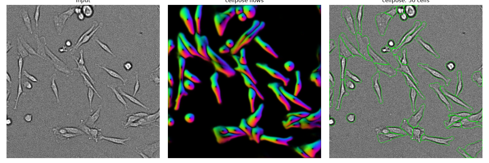
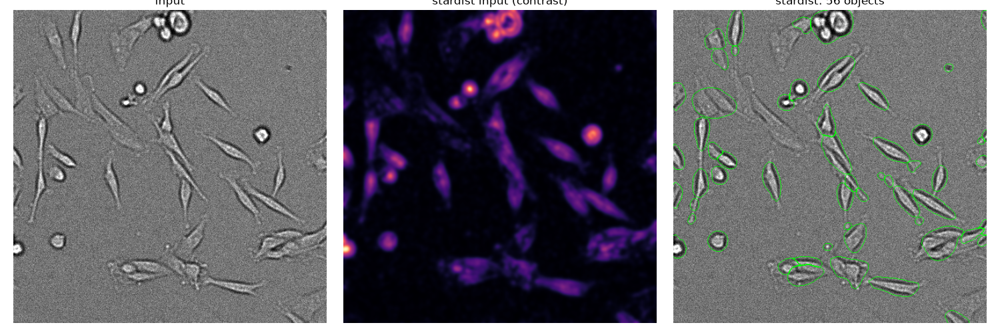
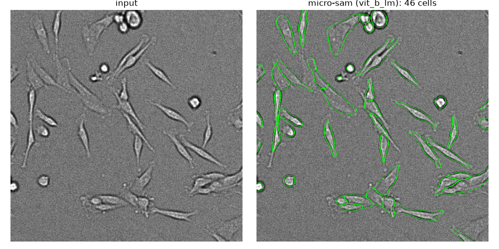

# Brightfield cell segmentation: methods tried and current pipeline

Dataset: `20261012_flucolandcells` (Micro-Manager acquisitions, adherent spindle-shaped cells, brightfield).
Machine used for development: Windows 11, CPU only (no GPU).

## Summary

- Four approaches were compared on a test image (`snap.tif`): a classical texture filter, Cellpose, StarDist and micro-sam.
- **micro-sam (`vit_b_lm`) gave the best results** and was chosen for the timelapse, with Cellpose a close second.
- The timelapse `justcells2d_brightfield_1/..._Pos0.ome.tif` (75 frames, 2048×2048, uint16) is segmented in 256×256 tiles with micro-sam.
- On this CPU that takes about **17 min per frame (~21 h for the stack)**. A GPU version of the script exists for faster processing on another machine.

## Data

| File | Contents |
|---|---|
| `snap.tif` | 513×513 uint8 brightfield test image |
| `justcells2d_brightfield_1/justcells2d_brightfield_1_MMStack_Pos0.ome.tif` | Timelapse, 75 frames × 2048×2048 uint16 (TYX). The acquisition was planned for 100 frames but stopped at 75; tifffile warns about the missing files. |

In the timelapse, cells are about the same size in pixels as in `snap.tif`, so settings tuned on the test image carry over. Some bright debris pushes the maximum intensity to ~1134 against a much lower background, so each frame is scaled to 8-bit by percentiles (0.5–99.8%) before segmentation.

## Methods compared (on `snap.tif`)

Each script writes `<image>_<method>_labels.tif` (16-bit label image, one integer per object) and `<image>_<method>_seg.png` (outlines drawn on the image).

| Method | Script | Objects | Assessment |
|---|---|---|---|
| Texture filter (classical) | `segment.py` | 26 | Finds most cells, but touching cells merge into one object. Not good enough. |
| Cellpose 4 (`cpsam`) | `segment-cellpose.py` | 50 | Very good. Splits touching cells and finds faint, flat cells. Outlines slightly looser. |
| StarDist (`2D_versatile_fluo`) | `segment-stardist.py` | 56 | Weakest. The model was trained on nuclei, so it fits rounded blobs, cuts off thin cell ends and splits some cells. |
| **micro-sam (`vit_b_lm`, AIS)** | `segment-microsam.py` | 46 | **Best.** Tightest outlines and follows thin cell ends. Slightly weaker on the faintest flat cells. |

### Texture filter

Brightfield cells have about the same brightness as the background, so an intensity threshold does not work. The background is flat, though, while cells have edges and internal structure. The script smooths the image, removes uneven illumination, computes the local standard deviation in a 9-pixel window, thresholds it (triangle method; Otsu missed faint cells), then cleans up the mask and labels objects. It is fast and needs no model, but it cannot separate touching cells.



### Cellpose

Uses the Cellpose 4 default model (`cpsam`) on CPU. The first run downloads a 1.15 GB model; including that, it took about 3.5 min. `--diameter` can be set if automatic size estimation is off.



### StarDist

StarDist only provides pretrained models for nuclei (fluorescence or H&E) and assumes star-convex shapes, which doesn't suit spindle cells. As a workaround, the script feeds it a smoothed contrast map (absolute deviation from local background) so cells look like bright objects on a dark background.

On Windows, `StarDist2D.from_pretrained()` fails with `WinError 1314` because unpacking the model needs symlink permissions. The script falls back to loading the already-extracted folder in `~/.keras/models/StarDist2D/2D_versatile_fluo/`.

Not recommended for this data. StarDist also pulls in TensorFlow, which makes the environment much larger; it could be removed.



### micro-sam

[micro-sam](https://github.com/computational-cell-analytics/micro-sam) (Segment Anything fine-tuned for microscopy). Uses the light-microscopy generalist model `vit_b_lm` with automatic instance segmentation (AIS). The first run took about 6 min including model download. `--model vit_l_lm` is a larger, slower alternative.



## Timelapse pipeline (micro-sam)

### CPU: `segment-microsam-stack.py`

```
uv run segment-microsam-stack.py justcells2d_brightfield_1/justcells2d_brightfield_1_MMStack_Pos0.ome.tif
```

- Uses micro-sam's tiled mode: 256×256 tiles with a 64-pixel overlapping halo. Cells crossing tile borders are stitched, and no seams were visible in the test frame.
- Each frame is saved as soon as it finishes, to `justcells2d_brightfield_1/justcells2d_brightfield_1_MMStack_Pos0_microsam_frames/t0000.tif`, `t0001.tif`, ...
- Rerunning skips frames that already exist, so an interrupted run resumes. `--frames 10:20` processes only a range.
- When all 75 frames exist, they are combined into `justcells2d_brightfield_1/justcells2d_brightfield_1_MMStack_Pos0_microsam_labels.tif` (16-bit label stack, TYX, opens in Fiji).

**Result on frame 1:** 827 cells in 1011 s (~17 min). The full stack would take ~21 h on this CPU. Frame 1 is done; the full run has not been started.

**Ways to speed it up on CPU** (not yet tested):
1. **Bigger tiles.** micro-sam scales every tile up to the same size before processing it, so the cost is per tile, not per pixel. 512×512 tiles mean 16 tiles per frame instead of 64, roughly 4× faster (~5 h total). Cells are small compared with 512 px, so quality should be similar.
2. **Smaller model.** `--model vit_t_lm` is several times faster with slightly rougher outlines.

### GPU: `segment-microsam-stack-gpu.py`

Same output and resume behaviour as the CPU script, but runs on an NVIDIA GPU via CUDA and sends several tiles through the model at once.

On the GPU machine:

```
uv sync --extra gpu
uv run --extra gpu segment-microsam-stack-gpu.py justcells2d_brightfield_1/justcells2d_brightfield_1_MMStack_Pos0.ome.tif
```

- Always include `--extra gpu` with `uv run`; without it uv switches torch back to the CPU build.
- Options: `--tile 256` (halo is a quarter of the tile), `--batch 8` (lower if the GPU runs out of memory), `--model`, `--frames`.
- Prints the GPU name on start. If no CUDA GPU is visible, it stops with a message instead of running on CPU.
- Writes to the same `_microsam_frames` folder as the CPU script, so frames finished on either machine are skipped.
- **Not tested on a GPU yet** (the development machine has none). Run `--frames 1:2` first to measure time per frame.

## Environment (uv)

Everything is managed with uv in this folder: `pyproject.toml` lists the direct dependencies, and `uv.lock` pins the exact version of every package.

- To recreate the environment on another machine, copy `pyproject.toml`, `uv.lock` and `.python-version`, then run `uv sync` (CPU) or `uv sync --extra gpu` (NVIDIA GPU).
- Python 3.13.
- micro-sam is installed from GitHub (it is mainly distributed through conda), pinned to release `v1.8.14`. To upgrade, change `rev` under `[tool.uv.sources]` and run `uv lock`.
- PyTorch 2.14.1:
  - Default: CPU build from PyPI.
  - `gpu` option: CUDA 12.6 build (`torch 2.14.1+cu126`, `torchvision 0.29.1+cu126`) from `https://download.pytorch.org/whl/cu126`. It needs an NVIDIA driver that supports CUDA 12.6 or higher (check with `nvidia-smi`).
- Other main packages: cellpose 4.2.1, stardist 0.9.2 + tensorflow 2.21, scikit-image 0.26, tifffile.

Model weights are downloaded on first use and cached outside the project:

| Tool | Cache location |
|---|---|
| Cellpose | `~/.cellpose/models` (1.15 GB) |
| StarDist | `~/.keras/models/StarDist2D` |
| micro-sam | `%LOCALAPPDATA%\micro_sam\micro_sam\Cache\models` |

## Open decisions and next steps

1. Choose how to run the full timelapse: 256-pixel tiles overnight on CPU (~21 h), 512-pixel tiles on CPU (~5 h, compare frame 1 first), or the GPU script on a GPU machine.
2. Check micro-sam output on a few more frames and positions, including the other acquisitions (`justcells2d_1`, `justcells2d_2`, `pollen1012`).
3. Optionally filter round, bright objects (likely detached or dead cells) by shape if they should not be counted.
4. If segmentation needs improving, correct results in micro-sam's napari annotator, or fine-tune Cellpose or micro-sam on a few hand-corrected frames.
5. Consider removing StarDist and TensorFlow from the environment.
6. For tracking cells over time, micro-sam's dependencies include trackastra, which could link the per-frame labels.
